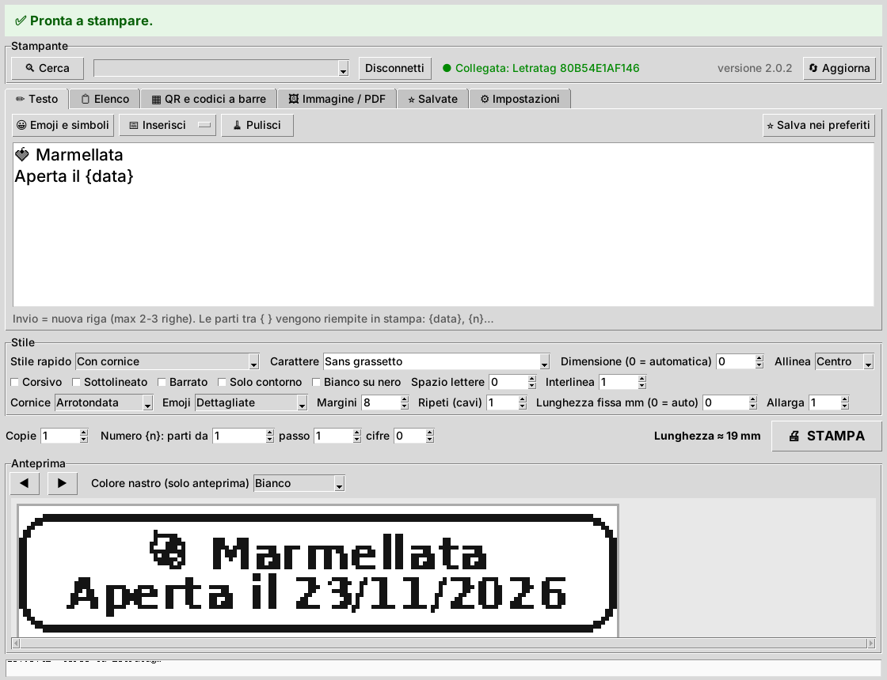
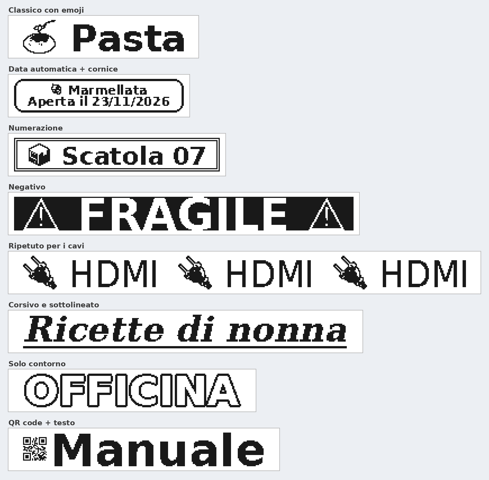
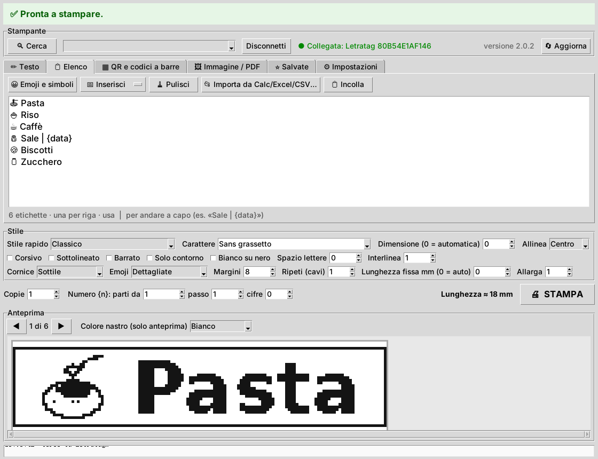
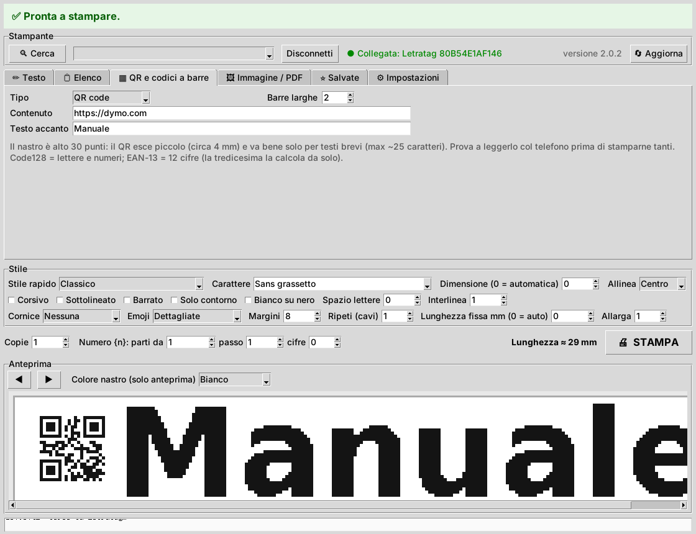
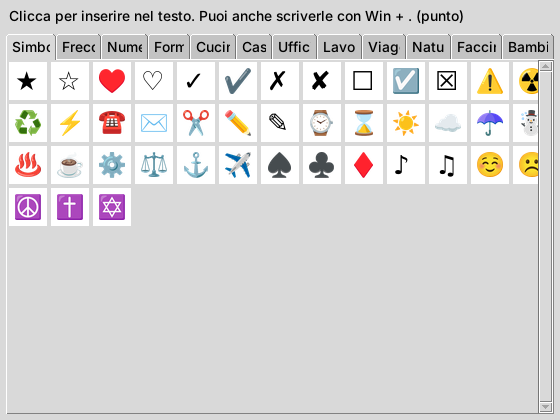
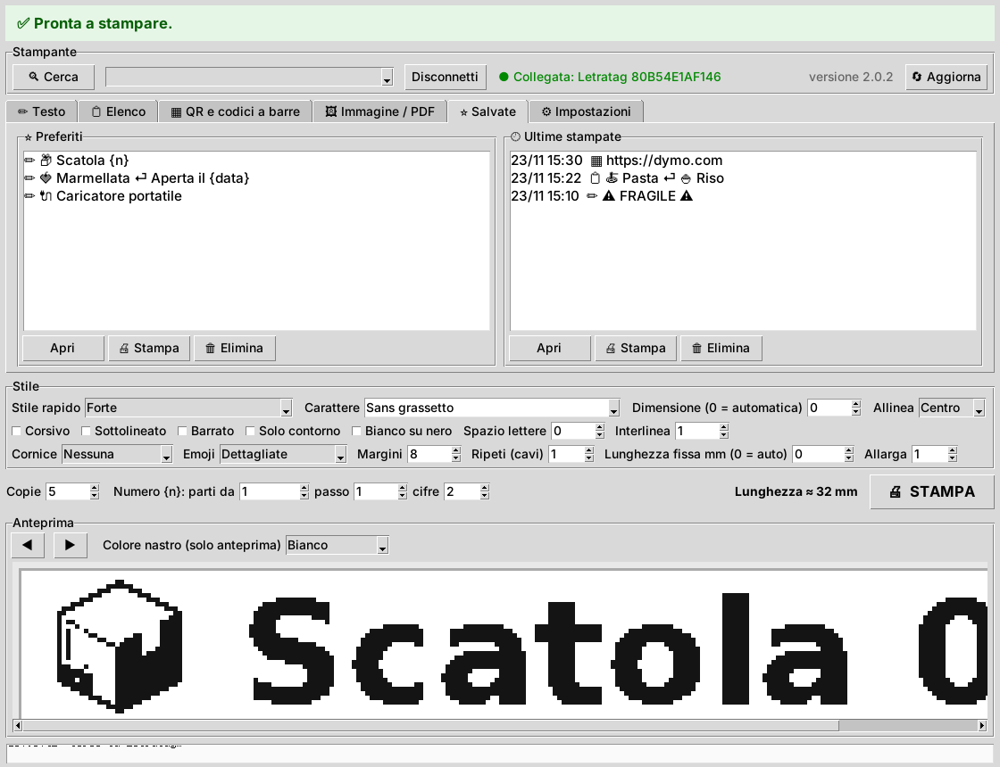

# Etichette LetraTag

🇮🇹 Italiano · 🇬🇧 [English below](#english)

[](https://github.com/giamorganti-pixel/etichette-letratag/releases/latest)


> ### ⬇️ Prima di tutto: [scarica Python per Windows](https://www.python.org/downloads/)
> Premi il pulsante giallo **Download Python** e installalo spuntando **Add python.exe to PATH**.
> Poi scarica l'app dall'[ultima versione](https://github.com/giamorganti-pixel/etichette-letratag/releases/latest) (**Source code (zip)**) e fai doppio clic su **INSTALLA.pyw**.

App per PC Windows che stampa etichette con la **DYMO LetraTag 200B** via Bluetooth, senza il telefono.

- Testo con tutti i caratteri del PC, stili rapidi, emoji e simboli
- Corsivo, sottolineato, barrato, contorno, bianco su nero, cornici
- Data automatica, numerazione (Scatola 1, 2, 3…), etichette ripetute per i cavi, lunghezza fissa
- Elenchi da Calc, Excel o CSV, QR code e codici a barre
- Preferiti e cronologia
- Interfaccia in italiano o inglese (menu 🌐)
- Pulsante «Stampa su LetraTag» dentro LibreOffice e OpenOffice
- Pulsante **🔄 Aggiorna**: le nuove versioni arrivano da questo repository

❤️ Ti è utile? Puoi offrirmi un caffè con [PayPal](https://paypal.me/GMorganti).

## Come è fatta



**Esempi di etichette** (anteprime come escono sul nastro):



| Elenco da stampare in serie | QR e codici a barre |
|---|---|
|  |  |
| **Emoji e simboli** | **Preferiti e ultime stampate** |
|  |  |

## Installazione

1. Installa **Python** da [python.org/downloads](https://www.python.org/downloads/) (spunta *Add python.exe to PATH*). Nello ZIP c'è anche il collegamento **1 - SCARICA PRIMA PYTHON** che apre la stessa pagina.
2. Apri l'[ultima versione](https://github.com/giamorganti-pixel/etichette-letratag/releases/latest) e scarica **Source code (zip)** (oppure, da questa pagina, **Code ▸ Download ZIP**). Poi clic destro sul file ▸ **Estrai tutto**.
3. Doppio clic su **INSTALLA.pyw** e premi **INSTALLA**.

Dopo, gli aggiornamenti si installano dall'app con il pulsante **🔄 Aggiorna**.

## Come funziona l'aggiornamento

`programma/versione.json` contiene il numero di versione e l'impronta SHA-256 di ogni file.
L'app lo confronta con la copia installata, scarica solo i file cambiati, controlla le impronte
e li sostituisce solo se sono tutti corretti.

Per pubblicare una versione nuova:

```
python sviluppo/pubblica.py 2.1.0 "Cosa c'è di nuovo"
git commit -am "Versione 2.1.0" && git push
```

## Note

La LetraTag 200B non ha driver per PC: l'app usa il protocollo Bluetooth ricostruito dalla
libreria open source [dymo-bluetooth](https://github.com/ysfchn/dymo-bluetooth) di ysfchn (licenza MIT).

Progetto indipendente, non affiliato né approvato da DYMO. DYMO e LetraTag sono marchi dei rispettivi proprietari.
Licenza: [MIT](LICENSE).

---

## English

**Print labels on a DYMO LetraTag 200B from a Windows PC over Bluetooth — no phone needed.**
DYMO only offers a mobile app for this printer; this project adds a full desktop app.

### Features
- Any font installed on the PC, quick styles, emoji and symbols (converted to black & white for the thermal head)
- Italic, underline, strikethrough, outline, inverted (white on black), frames
- Automatic dates (`{data}`, `{data+30}`), counters (`{n}` → Box 01, 02…), repeated text for cable wraps, fixed length
- Batch printing from a list or a spreadsheet (LibreOffice/OpenOffice Calc, Excel, CSV)
- QR codes, Code128 and EAN-13 barcodes
- Favourites and print history
- A "Print to LetraTag" button inside LibreOffice and OpenOffice
- One-click **Update** button: new versions are downloaded from this repository and verified with SHA-256

The interface is available in Italian and English (🌐 menu at the top right).

### Install
1. Install [Python 3.10+](https://www.python.org/downloads/) (tick *Add python.exe to PATH*).
2. Download **Source code (zip)** from the [latest release](https://github.com/giamorganti-pixel/etichette-letratag/releases/latest) and extract it.
3. Double-click **INSTALLA.pyw** and press **INSTALLA**.

Turn the LetraTag on and close the DYMO app on your phone (the printer accepts one connection at a time).
No Windows Bluetooth pairing is needed.

### How it works
The LetraTag 200B speaks Bluetooth Low Energy. The protocol was reverse-engineered by the
[dymo-bluetooth](https://github.com/ysfchn/dymo-bluetooth) library (MIT), which this app uses through
[bleak](https://github.com/hbldh/bleak). Labels are rendered with Pillow at the printer's 30-dot height.

❤️ Find it useful? You can support the project via [PayPal](https://paypal.me/GMorganti).

Independent project, not affiliated with or endorsed by DYMO. DYMO and LetraTag are trademarks of their respective owners.
License: [MIT](LICENSE).
